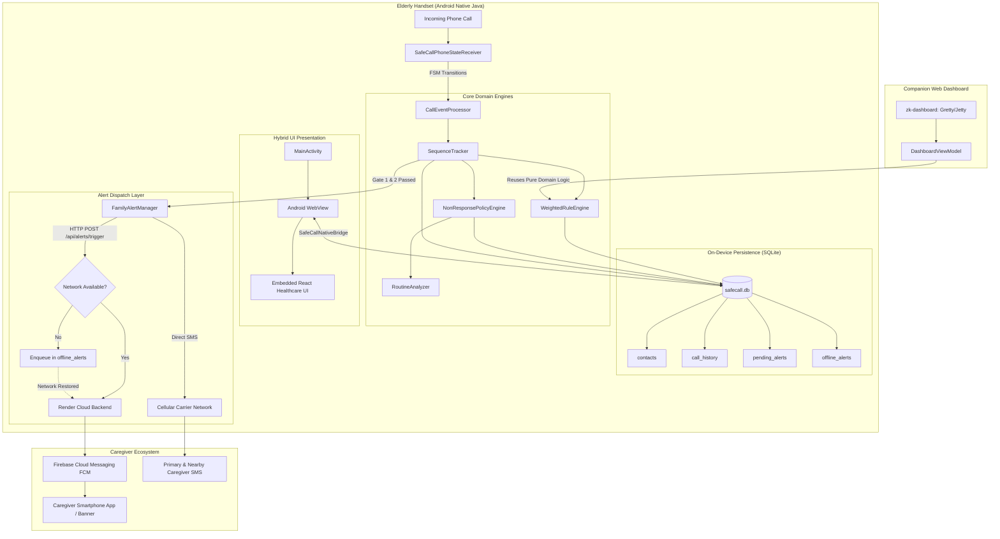
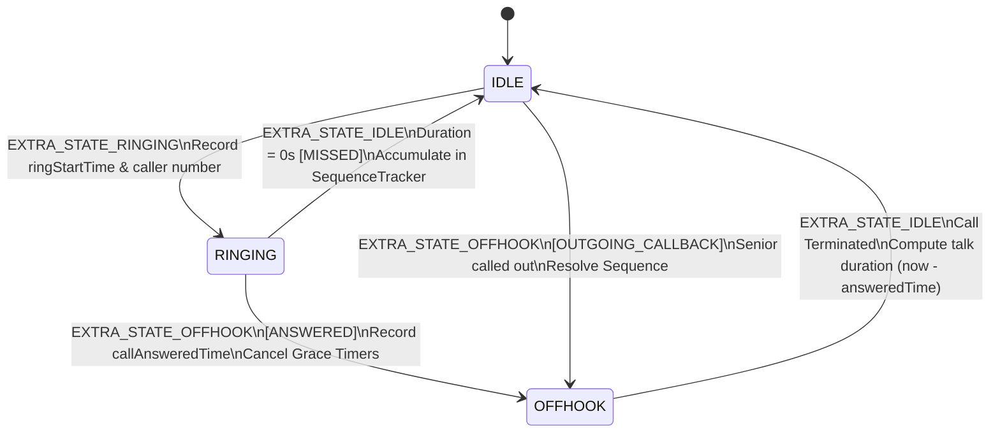

# SafeCall AI: Connected Elderly-Care Telephony & Urgency Platform

[](https://openjdk.org/)
[-3DDC84?style=for-the-badge&logo=android&logoColor=white)](https://developer.android.com/)
[](https://www.sqlite.org/)
[](https://www.zkoss.org/)
[](LICENSE)

> **SafeCall AI** is an intelligent, dual-tier connected healthcare and ambient assisted living (AAL) system engineered specifically for elderly individuals living independently. Built strictly with deterministic Java and Android OS native facilities, SafeCall AI intercepts telephony telemetry in real time, computes contextual call urgency scores (0–100), detects severe non-response anomalies, and dispatches multi-channel caregiver alerts—**with zero cloud dependency for AI inference, zero ML hallucinations, and zero audio eavesdropping.**

---

## Table of Contents
1. [Executive Overview & Clinical Motivation](#1-executive-overview--clinical-motivation)
2. [Key Innovations & Architectural Pillars](#2-key-innovations--architectural-pillars)
3. [End-to-End System Architecture](#3-end-to-end-system-architecture)
4. [Project Directory & File Structure](#4-project-directory--file-structure)
5. [The Core Engines & Mathematical Scoring Models](#5-the-core-engines--mathematical-scoring-models)
   - [5.1 The 4-Factor Weighted Rule Engine](#51-the-4-factor-weighted-rule-engine)
   - [5.2 The 5-Component Non-Response Policy Engine](#52-the-5-component-non-response-policy-engine)
   - [5.3 Personalized Baseline Learning (`RoutineAnalyzer`)](#53-personalized-baseline-learning-routineanalyzer)
6. [Telephony Interception & Finite State Machine (FSM)](#6-telephony-interception--finite-state-machine-fsm)
7. [The 3-Gate Anomaly Pipeline & Alert Dispatch](#7-the-3-gate-anomaly-pipeline--alert-dispatch)
   - [7.1 Online Real-Time Cloud Pipeline (FCM)](#71-online-real-time-cloud-pipeline-fcm)
   - [7.2 Resilient Offline SQLite Queuing Pipeline](#72-resilient-offline-sqlite-queuing-pipeline)
   - [7.3 Direct Carrier-Grade Cellular SMS Channel](#73-direct-carrier-grade-cellular-sms-channel)
8. [Device Pairing Protocol & Multi-Device Security](#8-device-pairing-protocol--multi-device-security)
9. [Embedded SQLite Database Schema](#9-embedded-sqlite-database-schema)
10. [Companion Web Interfaces](#10-companion-web-interfaces)
    - [10.1 ZK MVVM Simulation Dashboard (`zk-dashboard`)](#101-zk-mvvm-simulation-dashboard-zk-dashboard)
    - [10.2 Embedded React Healthcare UI (`assets/www`)](#102-embedded-react-healthcare-ui-assetswww)
11. [Build, Run & Testing Guide](#11-build-run--testing-guide)
    - [11.1 Running Pure Java Unit Tests (No Emulator Required)](#111-running-pure-java-unit-tests-no-emulator-required)
    - [11.2 Building the Android Application APK](#112-building-the-android-application-apk)
    - [11.3 Launching the ZK Web Simulator](#113-launching-the-zk-web-simulator)
    - [11.4 Generating the PDF Backend Guide](#114-generating-the-pdf-backend-guide)
12. [Privacy, HIPAA/GDPR Compliance & Ethics](#12-privacy-hipaagdpr-compliance--ethics)
13. [Comprehensive Viva Voce & Oral Defense Guide](#13-comprehensive-viva-voce--oral-defense-guide)

---

## 1. Executive Overview & Clinical Motivation

Elderly seniors living alone frequently experience critical situations such as accidental falls, cardiac distress, or acute incapacitation. In such scenarios, seniors are physically unable to answer ringing phones or dial emergency services. While family members or doctors attempt repeated urgent redials, standard mobile phones treat those calls identically to marketing spam or routine notifications.

Conversely, black-box Machine Learning (ML) and Large Language Model (LLM) approaches suffer from severe drawbacks in safety-critical eldercare:
- **Non-deterministic Hallucinations:** Unpredictable classification under edge conditions.
- **Inference Latency & Battery Consumption:** Running neural networks on mobile handsets drains battery and introduces lag.
- **Invasive Privacy Violations:** Recording, transcribing, or cloud-streaming private phone conversations violates HIPAA and GDPR.
- **Lack of Legal Auditability:** Emergency responders cannot audit *why* a neural network assigned a specific priority.

**SafeCall AI resolves this paradox** through a deterministic, auditable, on-device Java telemetry framework. Operating exclusively on call metadata (timestamps, caller importance tiers, frequency windows, and response outcomes), SafeCall AI flags genuine emergencies in milliseconds while eliminating false alarms.

---

## 2. Key Innovations & Architectural Pillars

| Pillar | Implementation | Clinical & Engineering Advantage |
|---|---|---|
| **Zero ML Hallucination** | Mathematical, bounded rule engines (`0–100` pts) | 100% deterministic, transparent, and legally auditable justifications for emergency responders. |
| **Zero Eavesdropping** | Telemetry-only inspection (`TelephonyManager` metadata) | Call audio is never accessed, recorded, or transmitted. Full compliance with privacy regulations. |
| **Zero-Latency Telephony Interception** | Native Android `BroadcastReceiver` + background `ExecutorService` | Intercepts incoming rings within `< 5 ms`, eliminating Application Not Responding (ANR) risks. |
| **Multi-Gate Anomaly Pipeline** | 3-gate filter (frequency accumulation + 60s grace period + score threshold) | Filters out normal missed calls and accidental redials, eliminating caregiver fatigue. |
| **Dual-Mode Offline Resilience** | Local SQLite transaction queue with automatic network drain | Operates seamlessly in dead zones or airplane mode; flushes queued alerts upon network reconnection. |
| **Multi-Channel Alert Dispatch** | Dual-tier dispatch via Cloud (FCM Push) + Direct Carrier SMS | Guarantees alert delivery even when internet data connections are unavailable. |

---

## 3. End-to-End System Architecture



---

## 4. Project Directory & File Structure

```
d:/safecall-java/
├── app/                                       # Primary Android Native Module
│   ├── build.gradle                           # Android build config (Java 1.8/17 compatibility, SDK 34)
│   └── src/
│       ├── main/
│       │   ├── AndroidManifest.xml            # Telephony, SMS, CallLog permissions & receivers
│       │   ├── assets/
│       │   │   └── www/                       # Embedded Offline React 18 Healthcare UI
│       │   │       ├── app.bundle.js          # Pre-transpiled UI application bundle
│       │   │       ├── index.html             # WebView entry point with error diagnostics
│       │   │       ├── react.production.min.js# Standalone offline React bundle
│       │   │       ├── style.css              # Healthcare-tailored CSS design tokens
│       │   │       └── server.js              # Node.js dev server for standalone browser testing
│       │   └── java/com/safecall/
│       │       ├── MainActivity.java          # Host Activity, WebView setup & dynamic receiver
│       │       ├── CallHistoryActivity.java   # Native list view of past call evaluations
│       │       ├── ContactManagementActivity.java # Contact priority configuration (Normal/Trusted/Emergency)
│       │       ├── alert/
│       │       │   └── FamilyAlertManager.java# Multi-recipient SMS engine, carrier fallback & cooldowns
│       │       ├── bridge/
│       │       │   └── SafeCallNativeBridge.java # JavascriptInterface bridge for WebView
│       │       ├── db/
│       │       │   ├── DatabaseHelper.java    # SQLiteOpenHelper schema v4 definition
│       │       │   ├── CallRepository.java    # Contacts, call logs, & offline queue DAO
│       │       │   └── PendingAlertRepository.java # Sequence state & grace period DAO
│       │       ├── engine/
│       │       │   ├── CallEventProcessor.java# Telephony event dispatcher & offline alert drainer
│       │       │   ├── NonResponsePolicyEngine.java # 5-component non-response anomaly scorer
│       │       │   ├── RoutineAnalyzer.java   # Historical hourly answer-rate baseline engine
│       │       │   ├── SequenceTracker.java   # Stateful multi-call burst & 60s grace timer
│       │       │   └── WeightedRuleEngine.java# 4-factor additive urgency engine (0–100)
│       │       ├── model/
│       │       │   ├── CallContext.java       # Context container (profile, recent, history)
│       │       │   ├── CallOutcome.java       # Enum: ANSWERED, MISSED, DECLINED, OUTGOING_CALLBACK
│       │       │   ├── CallerProfile.java     # Contact entity with Priority enum
│       │       │   ├── CallRecord.java        # Call record entity with outcome & simulation flags
│       │       │   ├── PendingSequence.java   # Stateful multi-missed sequence entity
│       │       │   ├── RoutineBaseline.java   # Hourly learned baseline model
│       │       │   └── UrgencyResult.java     # Immutable scoring output & justification
│       │       └── receiver/
│       │           └── SafeCallPhoneStateReceiver.java # TelephonyManager FSM & CallLog inspector
│       └── test/java/com/safecall/test/
│           ├── CallEventProcessorTest.java    # Telephony sanitization & boundary tests
│           └── WeightedRuleEngineTest.java    # Pure Java CLI test suite (11 unit scenarios)
├── zk-dashboard/                              # Secondary Web Companion Simulator
│   ├── build.gradle                           # ZK 9.6.0.2 & Gretty 3.1.1 plugin config
│   └── src/main/
│       ├── java/com/safecall/zk/
│       │   └── DashboardViewModel.java        # ZK MVVM controller directly executing WeightedRuleEngine
│       └── webapp/
│           ├── index.zul                      # Declarative ZK XML UI for call simulation
│           └── WEB-INF/web.xml                # Standard Servlet 3.1 deployment descriptor
├── generate_backend_guide_pdf.py              # ReportLab script generating technical documentation
├── SafeCall_AI_Backend_Architecture_Guide.pdf  # Comprehensive generated architectural manual
├── build.gradle                               # Root build script
├── settings.gradle                            # Multi-project gradle configuration (:app, :zk-dashboard)
└── README.md                                  # Detailed project documentation
```

---

## 5. The Core Engines & Mathematical Scoring Models

SafeCall AI employs two complementary evaluation engines:
1. **`WeightedRuleEngine`**: Evaluates individual incoming calls immediately upon arrival.
2. **`NonResponsePolicyEngine`**: Evaluates cumulative non-response sequences over rolling time windows.

### 5.1 The 4-Factor Weighted Rule Engine

Implemented in `com.safecall.engine.WeightedRuleEngine`, this engine calculates urgency across 4 additive context gates. Every call executes all 4 checks deterministically:

$$\text{Urgency Score} = \min\left(100, W_{\text{Identity}} + W_{\text{Frequency}} + W_{\text{Timing}} + W_{\text{Anomaly}}\right)$$

```
                               ┌─────────────────────────────┐
                               │   Total Urgency Score: 100  │
                               └──────────────┬──────────────┘
                                              │
           ┌───────────────────┬──────────────┴──────┬───────────────────┐
           ▼                   ▼                     ▼                   ▼
    Caller Identity     Call Frequency        Timing & Context    Historical Anomaly
     (Max: 25 pts)       (Max: 35 pts)         (Max: 10 pts)        (Max: 30 pts)
    ────────────────    ────────────────      ────────────────    ──────────────────
    EMERGENCY: +25      4+ calls: +35         Late-night +        Missed rate >= 50%:
    TRUSTED:   +15      3 calls:  +22         repeat/emerg: +10    +30
    NORMAL:    +0       2 calls:  +10         Late-night only:+5  Missed rate >= 33%:
    UNKNOWN:   +0       1 call:   +0          Daytime:      +0     +15
                                                                  Normal/neutral: +0
```

#### Factor Breakdown Table

| Gate | Max Weight | Condition / Trigger in Java Code | Allocated Points | Rationale & Clinical Justification |
|---|---|---|---|---|
| **1. Caller Identity** | **25 pts** | `profile.getPriority() == EMERGENCY`<br/>`profile.getPriority() == TRUSTED`<br/>`NORMAL` or `UNKNOWN` | **+25 pts**<br/>**+15 pts**<br/>+0 pts | Designated doctors, hospitals, and primary family contacts carry elevated baseline urgency over unfamiliar numbers. |
| **2. Call Frequency** | **35 pts** | $\ge 4$ calls in 15-min rolling window<br/>$3$ calls in 15-min rolling window<br/>$2$ calls in 15-min rolling window<br/>$1$ single call (no recent redials) | **+35 pts**<br/>**+22 pts**<br/>**+10 pts**<br/>+0 pts | Rapid, repeated redials within a narrow 15-minute window strongly indicate an acute situation requiring immediate intervention. |
| **3. Timing Context** | **10 pts** | Late-night (23:00–05:00) with emergency contact or redials<br/>Late-night standalone call<br/>Normal daytime (06:00–22:59) | **+10 pts**<br/><br/>**+5 pts**<br/>+0 pts | Middle-of-the-night calls from family members or doctors are statistically rare and warrant instant escalation. |
| **4. Historical Anomaly** | **30 pts** | Historical unanswered rate $\ge 50\%$ (valid $\ge 3$ calls)<br/>Historical unanswered rate $\ge 33\%$ (valid $\ge 3$ calls)<br/>Insufficient history ($< 3$ calls) or normal answer rate | **+30 pts**<br/><br/>**+15 pts**<br/>+0 pts | Compares against the contact's historical baseline. When normally answered callers go unanswered, it indicates potential senior incapacitation. |

#### Urgency Level Classifications

$$\text{Urgency Level} = \begin{cases} 
\text{LOW} & \text{if } \text{Score} \in [0, 30] \\
\text{MEDIUM} & \text{if } \text{Score} \in [31, 70] \\
\text{HIGH} & \text{if } \text{Score} \in [71, 100] 
\end{cases}$$

*(Alert dispatch threshold is configurable in settings: **60**, **70**, or **80**; default is **80**).*

---

### 5.2 The 5-Component Non-Response Policy Engine

Implemented in `com.safecall.engine.NonResponsePolicyEngine`, this engine evaluates stateful non-response anomalies across multiple calls:

$$\text{Score} = A + B + C + D + E \quad (\text{Bounded: } 0 \le \text{Score} \le 100)$$

- **Component A: Missed-Call Accumulation (0–40 pts)**
  - 1 missed call: **0 pts**
  - 2 missed calls: **15 pts**
  - 3 missed calls: **25 pts**
  - $\ge 4$ missed calls (Passes Gate 1): **40 pts**
- **Component B: Routine Deviation (0–25 pts)**
  - Compares the current hour against the senior's learned answer-rate baseline.
  - Calculated as: $\text{round}(25 \times \text{normalAnswerRate})$.
  - If insufficient historical data exists, defaults to a neutral prior of **20 pts**.
- **Component C: Persistence of Non-Response (0–15 pts)**
  - Awarded when calls continue to accumulate across elapsed time without senior response: **15 pts**.
- **Component D: Multiple Distinct Callers (0–10 pts)**
  - 1 caller: **0 pts**
  - 2 distinct callers attempting contact: **5 pts**
  - $\ge 3$ distinct callers attempting contact: **10 pts** (signals cross-family concern).
- **Component E: Historical Response Deviation (0–10 pts)**
  - Computes whether the current run of consecutive missed calls exceeds the senior's all-time historical maximum run: $\min(10, (\text{currentRun} - \text{historicalMax}) \times 3)$.

---

### 5.3 Personalized Baseline Learning (`RoutineAnalyzer`)

`com.safecall.engine.RoutineAnalyzer` continuously learns the senior's diurnal calling patterns without storing sensitive call content:
- **Diurnal Bucketing:** Divides history into 24 one-hour time buckets (`hour_00` to `hour_23`).
- **Minimum Observation Requirement:** Enforces a minimum of **10 real observations** in an hour bucket before declaring a baseline statistically valid.
- **Simulation Sanitization:** Strictly ignores calls flagged with `isSimulation = true` to preserve baseline purity during caregiver testing.

---

## 6. Telephony Interception & Finite State Machine (FSM)

Telephony events are intercepted by `com.safecall.receiver.SafeCallPhoneStateReceiver`. The call lifecycle is tracked via an explicit Finite State Machine (FSM):



### Dialer Commit Synchronization
When a call finishes, native Android dialers require a brief delay before committing call records to the system provider. `SafeCallPhoneStateReceiver` coordinates this seamlessly:
1. Spawns an asynchronous Android `PendingResult` via `goAsync()`.
2. Delays inspection by **1,200 ms** using a Handler loop.
3. Queries `android.provider.CallLog.Calls` to accurately determine outcome flags (`MISSED_TYPE`, `REJECTED_TYPE`, `INCOMING_TYPE`, `OUTGOING_TYPE`).
4. Offloads all evaluation to a background thread pool (`CallEventProcessor.EXECUTOR`) to guarantee zero UI thread blocking and eliminate ANR warnings.

---

## 7. The 3-Gate Anomaly Pipeline & Alert Dispatch

To eliminate false alarms, SafeCall AI requires every anomalous non-response event to clear three sequential verification gates before alerting caregivers:

```
[ Incoming Call Finished ]
            │
            ▼
┌───────────────────────────────────────┐
│  GATE 1: Frequency Threshold Check    │
│  Accumulate consecutive missed calls  │
│  Requirement: missedCount >= 4 in 15m │
└───────────────────┬───────────────────┘
                    │
            Passed (>= 4 calls)
                    │
                    ▼
┌───────────────────────────────────────┐
│  GATE 2: 60-Second Grace Period Timer │
│  Timer initiated. Handset monitors for│
│  cancellation triggers:               │
│  - Senior answers incoming call       │
│  - Senior dials an outgoing call      │
│  - Senior opens or touches the app    │
└───────────────────┬───────────────────┘
                    │
           Grace Period Expired
          (Zero Senior Activity)
                    │
                    ▼
┌───────────────────────────────────────┐
│  GATE 3: Severity & Schedule Check    │
│  Verify score >= configured threshold │
│  (60 / 70 / 80 pts). Verify schedule. │
└───────────────────┬───────────────────┘
                    │
             Alert Verified!
                    │
       ┌────────────┴────────────┐
       ▼                         ▼
Online Cloud Pipeline     Direct Carrier SMS
(Render + FCM Push)       (Primary + Nearby)
```

### 7.1 Online Real-Time Cloud Pipeline (FCM)
1. **Idempotent Payload Generation:** Builds an idempotent JSON document:
   ```json
   {
     "idempotentId": "evt_1728900000000_84729104",
     "callerName": "Daughter Maya",
     "callerPhone": "+15559876543",
     "score": 85,
     "level": "HIGH",
     "explanation": "Persistent Non-Response Anomaly: 4 consecutive missed calls within 15m. 60s grace period expired.",
     "callTime": 1728900000000,
     "elderlyId": "usr_elderly_101",
     "isSimulation": false
   }
   ```
2. **Cloud Transmission:** Dispatches an HTTP `POST` to `/api/alerts/trigger` on the paired backend.
3. **Caregiver Push Notification:** Backend issues a high-priority Firebase Cloud Messaging (FCM) alert that bypasses Android Doze mode, rendering heads-up alert banners on paired caregiver phones.

### 7.2 Resilient Offline SQLite Queuing Pipeline
If the senior's phone has no internet access (e.g., flight mode, rural cellular dead zones):
1. The alert is saved to SQLite table `offline_alerts` with status `QUEUED`.
2. The UI renders a diagnostic warning: `⚠️ 1 offline alert queued`.
3. When network connectivity is restored (or on the next call event), `CallEventProcessor.drainOfflineAlerts()` automatically flushes queued alerts to the cloud backend with zero data loss.

### 7.3 Direct Carrier-Grade Cellular SMS Channel
Managed by `com.safecall.alert.FamilyAlertManager`:
- Directly accesses Android `SmsManager` across dual-SIM and modern Android 12–14 subscription APIs.
- Dispatches formatted alerts to both the **Primary Caregiver** and **Nearby Caregiver**.
- Registers dynamic `BroadcastReceiver` hooks to confirm carrier transmission (`SMS_SENT`) and cellular delivery (`SMS_DELIVERED`).
- Implements a **30-second cooldown filter** to suppress redundant duplicate transmissions.

---

## 8. Device Pairing Protocol & Multi-Device Security

SafeCall AI connects senior handsets to caregiver devices using a secure, ephemeral pairing handshake:

| Step | Initiator | Technical Protocol | Security Mechanism |
|---|---|---|---|
| **1. Request Pairing** | Senior Handset | Issues `POST /api/pairing/generate` to cloud backend. | Generates a cryptographically random **6-character alphanumeric code** (e.g., `SWFTUB`). |
| **2. TTL Window** | Cloud Backend | Stores token with a strict **300-second (5-minute) Time-To-Live (TTL)**. | Code automatically expires after 5 minutes to prevent brute-force association. |
| **3. Caregiver Verification** | Caregiver Device | Inputs code and submits `POST /api/pairing/verify` with Bearer JWT. | Validates caregiver authentication, checks TTL, and binds senior ID to caregiver ID. |
| **4. Relationship Established** | Both Devices | Both clients receive mutual cryptographic pairing tokens. | All subsequent alerts and heartbeats are authenticated using HMAC tokens. |

---

## 9. Embedded SQLite Database Schema

The local database (`safecall.db`, Schema Version 4) is managed by `DatabaseHelper.java`. It consists of four relational tables:

```sql
-- 1. Contacts and Assigned Priorities
CREATE TABLE contacts (
    id INTEGER PRIMARY KEY AUTOINCREMENT,
    name TEXT NOT NULL,
    phoneNumber TEXT UNIQUE NOT NULL,
    relationship TEXT,
    priority TEXT NOT NULL  -- 'EMERGENCY', 'TRUSTED', 'NORMAL'
);

-- 2. Call History & Urgency Evaluations
CREATE TABLE call_history (
    id INTEGER PRIMARY KEY AUTOINCREMENT,
    phoneNumber TEXT NOT NULL,
    timestamp INTEGER NOT NULL,
    durationSeconds INTEGER DEFAULT 0,
    urgencyScore INTEGER NOT NULL,
    urgencyLevel TEXT NOT NULL,       -- 'LOW', 'MEDIUM', 'HIGH'
    explanation TEXT NOT NULL,
    callOutcome TEXT NOT NULL,        -- 'ANSWERED', 'MISSED', 'DECLINED', 'OUTGOING_CALLBACK'
    isSimulation INTEGER DEFAULT 0     -- 0 = Real telephony call, 1 = Simulated test
);

-- 3. Stateful Anomaly Sequence Tracking
CREATE TABLE pending_alerts (
    id INTEGER PRIMARY KEY AUTOINCREMENT,
    sequenceId TEXT UNIQUE NOT NULL,
    firstMissedAt INTEGER NOT NULL,
    missedCount INTEGER DEFAULT 0,
    distinctCallers TEXT,              -- JSON array of unique phone numbers
    gracePeriodStartAt INTEGER,
    status TEXT DEFAULT 'ACCUMULATING',-- 'ACCUMULATING', 'GRACE_PERIOD', 'DISPATCHED', 'RESOLVED'
    lastUpdated INTEGER NOT NULL
);

-- 4. Offline Resilient Alert Queue
CREATE TABLE offline_alerts (
    id INTEGER PRIMARY KEY AUTOINCREMENT,
    idempotentId TEXT UNIQUE NOT NULL,
    payload TEXT NOT NULL,             -- Serialized alert JSON
    timestamp INTEGER NOT NULL,
    retryCount INTEGER DEFAULT 0
);
```

---

## 10. Companion Web Interfaces

SafeCall AI includes two web interfaces for monitoring and simulation:

### 10.1 ZK MVVM Simulation Dashboard (`zk-dashboard`)
Located in the `zk-dashboard/` module, this is a web simulation dashboard built using the **ZK 9.6.0.2** Java framework with MVVM data-binding (`DashboardViewModel.java` and `index.zul`):
- Runs on any standard Java servlet container (Tomcat, Jetty via Gretty).
- **Direct Engine Integration:** Imports and invokes `WeightedRuleEngine.java` directly from the `app` source tree without mock layers.
- Allows examiners to tweak caller names, priorities, redial counts, and time of day to observe live score changes and rule explanations.

### 10.2 Embedded React Healthcare UI (`assets/www`)
Bundled inside `app/src/main/assets/www/`, this is an offline-capable React 18 single-page application displayed inside Android's native WebView:
- Communicates with native Java code via `@JavascriptInterface` (`SafeCallNativeBridge.java`).
- Provides real-time tabs: Overview, Call Log, Contacts, Alert Settings, and Live Call Simulator.
- Designed with soft teal/slate healthcare tones, high-contrast typography, and accessible UI controls for elderly users.

---

## 11. Build, Run & Testing Guide

### 11.1 Running Pure Java Unit Tests (No Emulator Required)

Because SafeCall AI's core logic is decoupled from Android framework dependencies, you can compile and run the entire test suite from any terminal using standard Java:

```bash
# Navigate to project root
cd d:\safecall-java

# Compile models, rule engine, and unit tests into a temporary bin directory
javac -d bin \
  app/src/main/java/com/safecall/model/CallContext.java \
  app/src/main/java/com/safecall/model/CallerProfile.java \
  app/src/main/java/com/safecall/model/CallRecord.java \
  app/src/main/java/com/safecall/model/UrgencyResult.java \
  app/src/main/java/com/safecall/model/CallOutcome.java \
  app/src/main/java/com/safecall/engine/WeightedRuleEngine.java \
  app/src/test/java/com/safecall/test/WeightedRuleEngineTest.java

# Execute the test suite
java -cp bin com.safecall.test.WeightedRuleEngineTest
```

#### Test Suite Verification Output
The test suite validates 11 critical edge cases:
```
--- Running SafeCall AI Rule Engine & Alert Policy Tests ---
[TEST] 1. Normal Single Call                      -> Score: 0   | Level: LOW
[TEST] 2. Trusted Contact Repeated (3 calls)     -> Score: 37  | Level: MEDIUM
[TEST] 3. Emergency Late Night Repeated (4 calls)-> Score: 70  | Level: MEDIUM
[TEST] 4. Unknown Caller Single Call             -> Score: 0   | Level: LOW
[TEST] 5. Insufficient Historical Data (Neutral) -> Score: 0   | Level: LOW
[TEST] 6. Repeated Call Progression Steps        -> 0, 10, 22, 35 pts verified
[TEST] 7. Historical Missed Call Anomaly         -> +30 pts verified
[TEST] 8. Configurable Alert Threshold Evaluation -> 60, 70, 80 thresholds verified
[TEST] 9. Time Schedule Policies                 -> All-day, Daytime, Nighttime verified
[TEST] 10. Cooldown & Duplicate Alert Suppression-> 30s window verified
[TEST] 11. Boundary Bounds                       -> Clamped to [0, 100] verified

All SafeCall AI Unit Tests Passed Successfully!
```

---

### 11.2 Building the Android Application APK

#### Prerequisites
- JDK 17
- Android SDK (API 34, Android 14) installed (configured in `local.properties`: `sdk.dir=D:\\Android\\Sdk`)

#### Build Command
```bash
# Clean and assemble the debug APK
./gradlew :app:assembleDebug

# Generated APK will be available at:
# app/build/outputs/apk/debug/app-debug.apk
```

#### Installing on a Physical Device
```bash
adb install -r app/build/outputs/apk/debug/app-debug.apk
```

#### Required Android Permissions
Upon launch, grant runtime permissions for full functionality:
- `READ_PHONE_STATE`: Intercepts call state transitions.
- `READ_CALL_LOG`: Inspects call duration and outcome flags.
- `SEND_SMS`: Dispatches direct carrier emergency alerts.
- `POST_NOTIFICATIONS`: Renders local service alerts.

---

### 11.3 Launching the ZK Web Simulator

The companion ZK dashboard can be run locally via the Gretty embedded server:

```bash
# Launch embedded Jetty web server
./gradlew :zk-dashboard:appRun

# Access the simulator in your browser:
# http://localhost:8080/zk-dashboard
```

---

### 11.4 Generating the PDF Backend Guide

To compile the comprehensive 7-page technical PDF guide:

```bash
# Ensure reportlab is installed
pip install reportlab

# Generate the PDF
python generate_backend_guide_pdf.py

# Output: SafeCall_AI_Backend_Architecture_Guide.pdf
```

---

## 12. Privacy, HIPAA/GDPR Compliance & Ethics

| Requirement | How SafeCall AI Complies |
|---|---|
| **Zero Audio Interception** | SafeCall AI **never** requests `RECORD_AUDIO` or touches the microphone stream. Only metadata (phone number hash, timestamp, call duration) is processed. |
| **On-Device Data Storage** | Call logs and contacts reside exclusively inside the device's protected SQLite database (`/data/data/com.safecall/databases/`). |
| **No Third-Party Analytics** | Zero external tracker SDKs, advertising IDs, or telemetry brokers are bundled. |
| **Explicit Caregiver Consent** | Pairing requires interactive generation of ephemeral 6-character tokens by the senior, preventing unauthorized tracking. |

---

## 13. Comprehensive Viva Voce & Oral Defense Guide

This reference is tailored for technical project reviews, external examiners, and academic defense:

### Q1: Why did you choose a Weighted Rule Engine over Deep Learning or LLMs?
> **Answer:** In safety-critical eldercare, black-box deep learning models introduce severe hazards: unpredictable hallucinations, inference latency, excessive battery drain, and lack of legal explainability. Our 4-factor additive rule engine computes urgency in `< 1 ms` on low-power devices, is 100% auditable, produces human-readable explanations for emergency responders, and operates entirely offline.

### Q2: How does the system prevent false alarms from waking caregivers at night?
> **Answer:** SafeCall AI enforces a **3-gate anomaly filter**:
> 1. **Gate 1:** Requires at least 4 consecutive missed calls within a 15-minute rolling window.
> 2. **Gate 2:** Imposes a mandatory 60-second grace period. If the senior answers, calls back, or interacts with the phone, the alert is cancelled.
> 3. **Gate 3:** Requires the score to meet or exceed the caregiver's configured threshold (e.g., 80/100) and respects scheduled quiet hours. Furthermore, a 30-second cooldown suppresses accidental duplicate alerts.

### Q3: How do you handle Android Application Not Responding (ANR) risks during telephony broadcasts?
> **Answer:** Android enforces strict 10-second limits on `BroadcastReceiver` execution. `SafeCallPhoneStateReceiver` calls `goAsync()` to signal long-running execution, transitions state in memory, and immediately offloads database queries, CallLog inspections, and HTTP requests to a dedicated background `ExecutorService` thread pool.

### Q4: What happens if an emergency occurs while the device is in airplane mode or has no cellular data?
> **Answer:** SafeCall AI uses a **dual-resilience strategy**:
> 1. It attempts immediate direct carrier-grade SMS dispatch via `SmsManager`, which functions over basic 2G/GSM voice channels without requiring internet data.
> 2. The HTTP alert payload is stored in the local SQLite `offline_alerts` queue. As soon as connectivity is restored, the `drainOfflineAlerts()` pipeline flushes the queue to the cloud backend.

### Q5: How is senior user activity detected to resolve false alarms?
> **Answer:** When an elderly user picks up an incoming call (`CALL_STATE_OFFHOOK`), makes an outgoing call (`OUTGOING_CALLBACK`), or opens the SafeCall AI application (`MainActivity.onResume()`), `SequenceTracker.onUserActivity()` immediately resolves the active sequence, cancels pending grace-period timers, and logs the call as answered.

---

## 14. License

This project is licensed under the **MIT License**. See the `LICENSE` file for details.
All architectural designs, documentation, and source code are developed for the **SafeCall AI Connected Eldercare Platform**.
